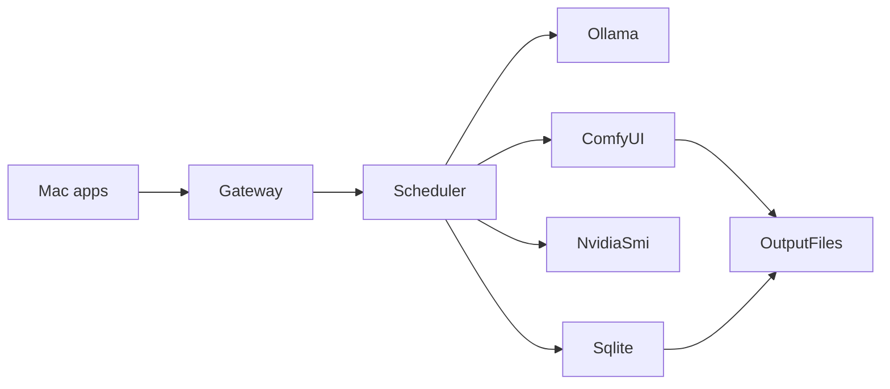
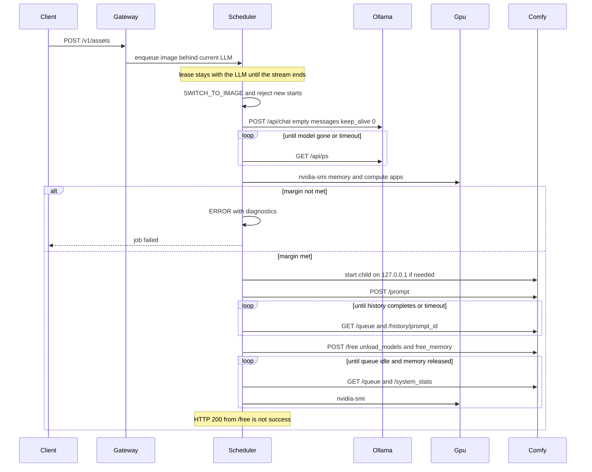
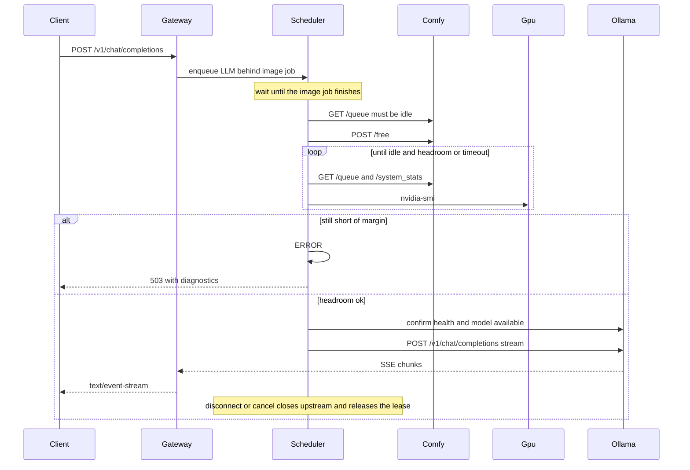

# Local AI Switchboard architecture

Phase 0 plan. No application code is written until Phase 1 is explicitly started. Each later phase ends with tests, a file list, and a written "what works / what remains" note, then stops.

The gateway does not authenticate callers. The network boundary is the Windows firewall rule: Private profile, `LocalSubnet`, and the configured gateway TCP port. Any device on that trusted LAN subnet can call the gateway.

Development is on this Mac. The runtime is the Windows 11 PC with the RTX 4060 8 GB. Mocked pytest runs here. Real GPU behavior is a Windows checklist and is never reported as passed unless it was actually run on that PC.

## Architecture overview

One Python 3.12 process on Windows. FastAPI is the only LAN listener. Ollama and ComfyUI stay on localhost. An in-process async scheduler is the only component allowed to start GPU work or switch providers.



- Mac clients (Cursor, Open CoDesign, browser, `generate_asset.py`) call the Gateway over the private LAN.
- Gateway default bind is `0.0.0.0:8787`, configurable. One Windows Firewall inbound rule: Private profile, remote address `LocalSubnet`, TCP on the configured gateway port only. The rule name is `LocalAISwitchboard-<port>`.
- Ollama stays at `http://127.0.0.1:11434`. The installer sets the user environment variable `OLLAMA_HOST=127.0.0.1:11434`. Ollama already defaults to localhost; the variable makes that explicit. The Gateway does not start a second Ollama.
- ComfyUI is a child process, started only when an image job needs it: `<portable>\python_embeded\python.exe -s ComfyUI\main.py --listen 127.0.0.1 --port 8188 --disable-auto-launch --windows-standalone-build`, plus a configurable `--reserve-vram`. The embedded interpreter is discovered by path, not guessed. A bare `--listen` is forbidden because ComfyUI treats that as `0.0.0.0,::`.
- Chat holds the GPU lease until the SSE stream ends, the client disconnects, or the job is cancelled. Image jobs hold it until history shows completion and outputs are copied, or until a safe failure.
- Same-provider work does not reload. Sequential LLM calls leave `qwen3.5:4b` resident. Unload runs only when the next job needs the other provider, on shutdown, or after the configurable idle timeout.

Verified API facts that the scheduler will rely on:

- Unload Ollama with native `POST /api/chat` and `{"model","messages":[],"keep_alive":0}`. Success includes `done_reason: "unload"`. Confirm with `GET /api/ps` (`models[].name`, `size_vram`). `keep_alive` on `/v1/chat/completions` is not the unload mechanism.
- Chat forwarding uses Ollama `POST /v1/chat/completions`. Current Ollama documents support for streaming, tools, and base64 vision. It does not support `tool_choice`, remote image URLs, `logit_bias`, `user`, or `n`. Those fields produce a 400 from the Gateway. They are not stripped.
- `qwen3.5:4b` on the Ollama library is text and image input, about 3.3–4.0 GB on disk, with tools and thinking. Runtime VRAM is larger than the file size once context is allocated.
- ComfyUI `POST /free` with `{"unload_models":true,"free_memory":true}` only sets queue flags and returns HTTP 200. Reclamation happens later, on an idle queue tick. The Gateway polls `GET /queue`, `GET /system_stats` (`devices[0].vram_free` and `torch_vram_free`), and `nvidia-smi` until the margin is met or the timeout fires.
- Image submit is `POST /prompt`. Completion is `GET /history/{prompt_id}` plus an empty running/pending queue. Bytes come from `GET /view?filename&subfolder&type=output`.
- The official FLUX.2 Klein text-to-image template is a UI subgraph, not a `/prompt` API graph. Node ids will not be invented. The design profile cannot generate images until a real API export from the installed ComfyUI is registered.

VRAM constraint for this exact GPU: Windows display memory plus a loaded Ollama model plus FLUX.2 Klein 4B will not coexist in 8 GB. The image setup is the FP8 diffusion weights, the FP4 text encoder, and the VAE (`flux-2-klein-4b-fp8.safetensors`, `qwen_3_4b_fp4_flux2.safetensors`, `flux2-vae.safetensors`), 768×768, batch size 1, and a memory gate with a configurable margin (default 1024 MB) before the destination provider starts. This pin does not prove those weights stay fully resident in 8 GB. ComfyUI offloading and a real RTX 4060 run are still required. If the gate fails, the job fails with diagnostics. The second provider is not started. The full-size `qwen_3_4b.safetensors` file is not a substitute.

## Component responsibilities

- `api/`: HTTP schemas and route handlers. Handlers submit work to the scheduler. They do not call Ollama or ComfyUI themselves. Routes do not require a credential.
- `config/`: Pydantic Settings. Install root, URLs, queue limits, timeouts, memory margin, and workflow directory.
- `scheduler/`: the single GPU authority. FIFO queue, lease generation, state machine, transition steps, cancellation, shutdown, and startup recovery. A lease generation counter ignores a late release from an older job.
- `providers/base.py`: health, prepare, run, cancel, release_memory. No GPU work except when the scheduler calls it.
- `providers/ollama.py`: `/api/tags`, `/api/ps`, `/api/show`, native unload, and transparent proxy of `/v1/chat/completions` including SSE bytes. Unsupported fields return an error body that names them.
- `providers/comfyui.py`: process start/stop using a fixed argv list (`shell=False`), health, allowlisted workflow submit, `/queue`, `/history/{id}`, `/view`, `/interrupt`, `/free`. No arbitrary workflow JSON from the network.
- `gpu/nvidia_smi.py`: parse `nvidia-smi` CSV for GPU memory and compute apps. `gpu/monitor.py`: combine that snapshot with Ollama `/api/ps` and ComfyUI `/system_stats`. Global free memory alone is never treated as proof of ownership.
- `jobs/`: job records and state. Image generation returns immediately with a job id.
- `storage/`: SQLite for metadata, filesystem for images, retention sweep, path confinement.
- `services/`: startup recovery, logging, preflight. No extra network services.
- `main.py`: FastAPI app and lifespan. Startup marks leftover running jobs interrupted, opens SQLite, starts the scheduler at `IDLE`. Shutdown moves to `STOPPING`, cancels queued work, interrupts an in-flight ComfyUI prompt, and releases the lease.

Scheduler phase is global. Job status is separate: `queued`, `running`, `succeeded`, `failed`, `cancelled`, `interrupted`.

Global phases: `IDLE`, `LLM_QUEUED`, `LLM_STARTING`, `LLM_ACTIVE`, `SWITCH_TO_IMAGE`, `IMAGE_QUEUED`, `IMAGE_STARTING`, `IMAGE_ACTIVE`, `SWITCH_TO_LLM`, `ERROR`, `STOPPING`.

`ERROR` refuses new GPU work until cleanup succeeds. `STOPPING` is shutdown only. Queue depth and wait time are metrics, not extra phases.

Lock rule: mutate scheduler state under one mutex, and never await a provider while holding it. Provider I/O runs under the lease, outside the mutex. That is the deadlock rule.

On Gateway or Windows restart: persisted `queued` and `running` jobs become `interrupted` unless a completion marker already shows the image file was written. Completed files stay. No image workflow is resumed. Startup recovery inspects Ollama and ComfyUI before the scheduler accepts GPU work. It does not boot straight to `IDLE` while a managed provider still holds VRAM.

## Provider transitions





Streaming disconnect: the response task cancellation closes the upstream httpx stream in `finally`, completes the job as `cancelled`, and only then lets the worker take the next FIFO item. A cancelled waiter that has not been granted the lease is removed from the queue and never starts a provider.

## Repository structure

```
src/local_ai_switchboard/
  api/            routes, deps, schemas
  config/         settings
  scheduler/      queue, lease, transitions, states
  providers/      base.py, ollama.py, comfyui.py
  gpu/            monitor.py, nvidia_smi.py
  jobs/
  storage/
  services/       logging, preflight, recovery
  main.py
tests/            unit and mocked API tests
  fixtures/       tiny fake Comfy graph, not claimed to be FLUX
workflows/        manifest schema; real API JSON only after Windows export
client/macos/generate_asset.py
installer/        install.ps1, doctor.ps1, start.ps1, stop.ps1, update.ps1, uninstall.ps1, pins.json
docs/             the ten requested documents
README.md
pyproject.toml
```

Runtime data stays outside git, under the configurable install root: `config/`, `logs/`, `data/switchboard.db`, `outputs/images/`, `models/ollama/`, and the ComfyUI portable tree. `.gitignore` excludes those plus `.env`. The gateway does not create a secret file.

HTTP surface, matching the spec:

- Every route works without a credential: `GET /health/live`, `GET /health/ready` with only `ok` or `degraded`, `GET /v1/models`, `POST /v1/chat/completions`, `POST /v1/assets`, `GET /v1/jobs/{job_id}`, and `GET /v1/jobs/{job_id}/download`. Ready does not include paths or GPU detail. `/health/ready` is degraded when startup GPU recovery did not finish.
- Chat is OpenAI-shaped SSE. Images return a job id immediately. Download is confined to the managed output directory.
- CORS is off. No telemetry. No shell from request input.

Mac client config is `~/.config/local-ai-switchboard/config.json` and contains `gateway_url` only. The script uses only the Python standard library and retries with a timeout. Open CoDesign has no ComfyUI provider today. The Gateway is the OpenAI-compatible text endpoint and `generate_asset.py` is the image path. It does not add a plugin.

Installer rules: interactive by default, silent parameters, `-WhatIf`, idempotent reruns, no silent overwrite of config, admin only for the firewall step, no driver changes, no `Invoke-Expression` of downloaded code, pinned assets in `installer/pins.json`. Official model blobs without a published checksum are downloaded only after explicit consent, and the manifest records that limitation. Ollama weights stay in `OLLAMA_MODELS`. Comfy weights stay in the portable model folders. Neither is committed.

Profiles: `Basic` is Gateway, Ollama, `qwen3.5:4b`, and GPU monitoring. `Design` adds ComfyUI Portable NVIDIA, the FP8 Klein diffusion weights, the FP4 text encoder, the VAE, the workflow slot, and the Mac client instructions. `Design` is the recommended default. Already installed pieces can be skipped.

Startup is a per-user scheduled task at logon, not a Windows service, so CUDA stays in the user session and elevation stays optional. The task restarts the Gateway on failure. It does not restart a half-finished image job.

## Main technical risks

- 8 GB is tight. `qwen3.5:4b` can occupy several GB with context. Klein 4B FP8 plus the FP4 Qwen3 text encoder plus Windows WDDM can still exceed 8 GB if unload is incomplete or ComfyUI keeps weights resident. The FP4 pin is smaller than the old full-size encoder, and it still does not prove an all-VRAM fit. The memory gate and 768×768 default exist because of this. FP16 Klein is out of scope. ComfyUI offloading and an RTX 4060 measurement remain required.
- `POST /free` and Ollama unload are both asynchronous. Polling `/api/ps`, `/queue`, `/system_stats`, and `nvidia-smi` compute apps is required. A timeout must fail closed.
- ComfyUI's compute app name is `python.exe`, so process name alone cannot identify ownership. Provider residency APIs are the primary signal. `nvidia-smi` is corroboration.
- The official Klein template cannot be submitted as-is to `/prompt`. Shipping a hand-written node graph would violate the spec. Image generation stays disabled until an API export from that ComfyUI build is bound in the manifest. Tests use a clearly fake graph.
- Ollama `/v1/chat/completions` omits `tool_choice` and remote image URLs. Returning 400 is the compatible behavior. Thinking models may emit reasoning fields; they are passed through, not dropped.
- ComfyUI Portable and Ollama installers move. `pins.json` must name an exact asset. A floating "latest" URL is not acceptable. Checksums are recorded when the vendor publishes them.
- This Mac cannot execute the PowerShell installer or the RTX 4060 path. Installer confidence here is static review plus mocked tests. Hardware confidence waits for the Windows checklist.
- Killing ComfyUI when `/free` fails would hide a leak and can leave the GPU driver in a bad CUDA state. Default is to enter `ERROR` and not kill the process. An operator can stop it with `installer/stop.ps1`.

## Implementation plan

Phase 1 is the only coding phase authorized after approval. Phases 2–8 stay written here and start only when requested, after the previous phase's review.

### Phase 1: skeleton, settings, logging, health, preflight

Create the package, `pyproject.toml` (FastAPI, Uvicorn, Pydantic Settings, httpx, pytest, pytest-asyncio), settings, JSON logging with rotation and redaction, request ids, `GET /health/live` and `GET /health/ready`, and a preflight report that checks config and configured URLs without starting providers.

Acceptance: mocked tests show live is open, ready does not leak secrets, logs redact credential-shaped text, and settings reject an unsafe bind for Ollama or ComfyUI. Pytest passes on this Mac.

### Phase 2: GPU monitor and scheduler core

Implement `nvidia-smi` parsing behind an interface, the FIFO scheduler, lease generation, all global states, queue limits, timeouts, cancellation of waiters, and both transition sequences against fake providers.

Acceptance: tests cover serialization, no reload between two LLM jobs, both transitions, disconnect releasing the lease, cleanup timeout, insufficient memory, and no lock leak after cancellation. No real GPU required.

### Phase 3: Ollama and Chat Completions

Implement the Ollama adapter and `GET /v1/models` plus `POST /v1/chat/completions`, including SSE pass-through, tools, and base64 images. Reject unsupported fields. Unload and `/api/ps` are used only by the scheduler.

Acceptance: tests 1, 2, 6, 8, and 12 that apply to chat pass against a mocked Ollama. A direct provider call from a route is absent. Chat does not require a credential.

### Phase 4: ComfyUI process control and image jobs

Implement process argv construction, health, allowlisted submit, queue and history polling, `/view` copy, `/interrupt`, and `/free` followed by memory polling. `POST /v1/assets` returns a job id. Workflow manifests declare supported parameters. `negative_prompt` or `output_format` is rejected when the manifest has no binding.

Acceptance: tests 3, 4, 5, 7, 9, 10, and 14 pass with mocks. The FLUX file is not a fabricated graph. Unknown workflow ids return 404 or 400. ComfyUI launch args include `--listen 127.0.0.1` and never a bare `--listen`.

### Phase 5: persistence and Mac client

Add SQLite job metadata, safe filenames, retention, restart recovery, and `client/macos/generate_asset.py`.

Acceptance: tests 11, 13, 15, and 16 pass. Restart marks an in-flight image job `interrupted` and does not resubmit it. Path traversal and odd Unicode paths fail or save only inside the allowed directory. The client test uses a local mocked Gateway and does not send a credential.

### Phase 6: Windows installer and lifecycle

Add the six PowerShell scripts, `pins.json`, profile selection, the firewall rule, the user logon task, and the version manifest. Include `-WhatIf`. Do not generate a token.

Acceptance: script review shows idempotency, no unconditional `Invoke-Expression`, no driver installation, and localhost binds for both providers. A dry-run text test can run only if PowerShell is available; otherwise the gap is documented. Live install is part of the Windows checklist, not a Mac claim.

### Phase 7: Open CoDesign documentation

Write the Mac and Open CoDesign docs: Gateway base URL `http://<windows-lan-ip>:8787/v1`, an empty API key, model `qwen3.5:4b`, and image generation through the standard-library script. State that Open CoDesign cannot call ComfyUI directly.

Acceptance: every command is labeled Windows PowerShell or macOS Terminal, and the examples use the RTX 4060 / M1 setup.

### Phase 8: security pass, tests, and the remaining docs

Finish README, architecture, installation, Windows setup, workflow setup, troubleshooting, security, and testing docs. Add the Windows hardware checklist. Review the trusted-LAN boundary, path checks, log redaction, queue limits, CORS, and firewall scope.

Acceptance: the fifteen behavioral scenarios are covered by automated tests or explicitly listed as hardware-only. Docs do not say the RTX 4060 tests passed. `docs/TESTING.md` separates Mac mocked results from the Windows checklist.

Windows checklist, to be executed later on the target PC and not before: driver visible in `nvidia-smi`, Ollama and ComfyUI bound to localhost only, Gateway reachable from the Mac on the private subnet, one LLM stream, a second LLM without reload, one 768×768 Klein image after unload, a chat request after that image, a disconnect during streaming, a forced `/free` timeout, and an interrupted job after a Gateway restart.
